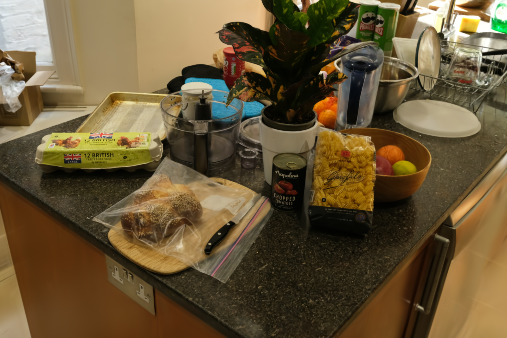
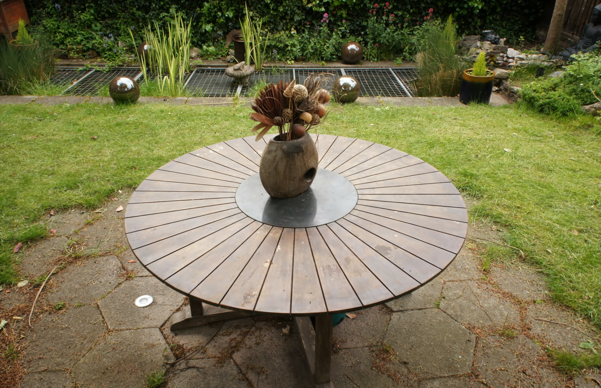
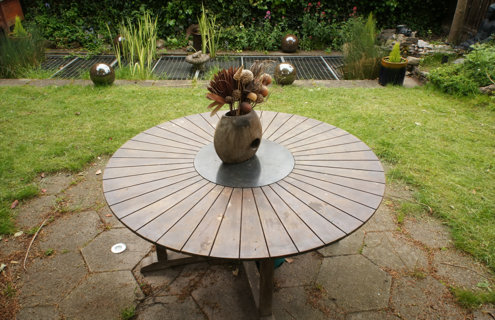
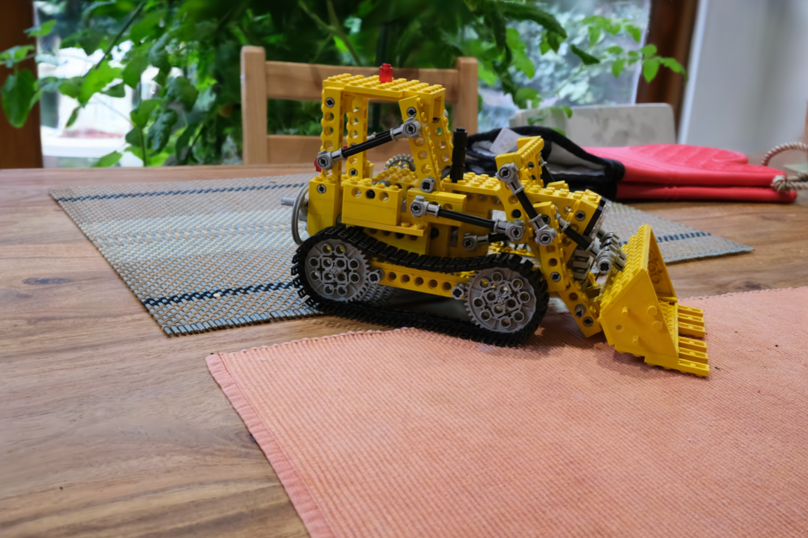
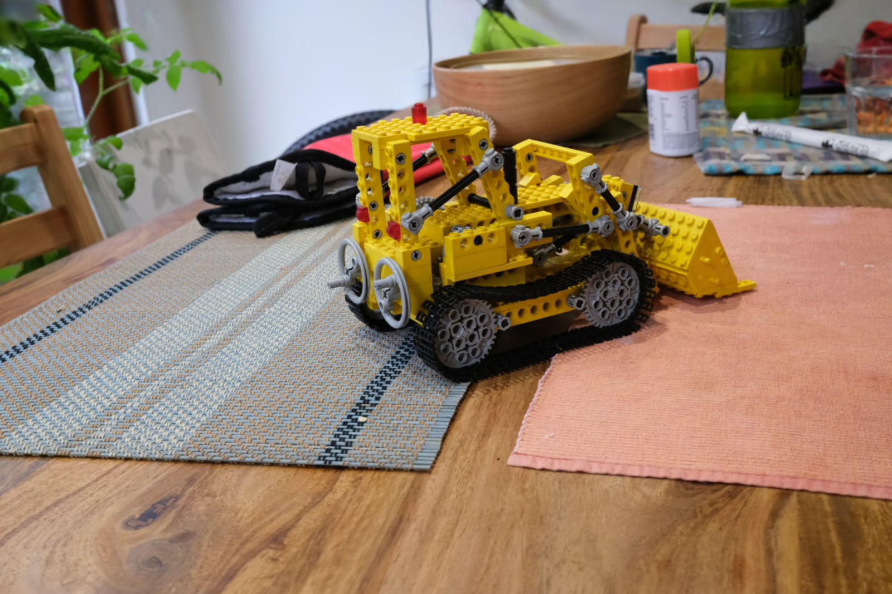
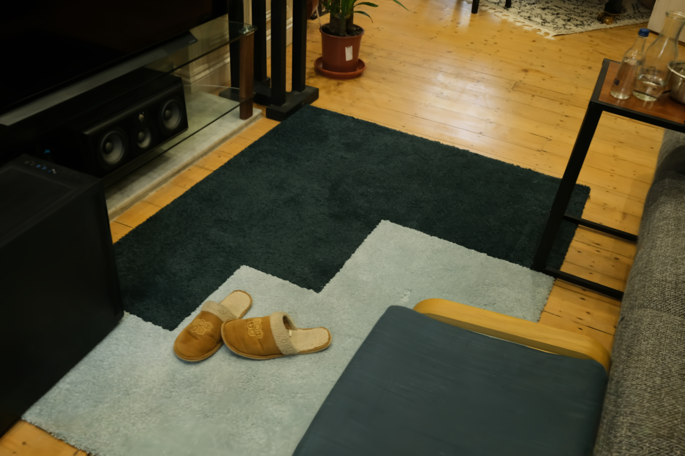
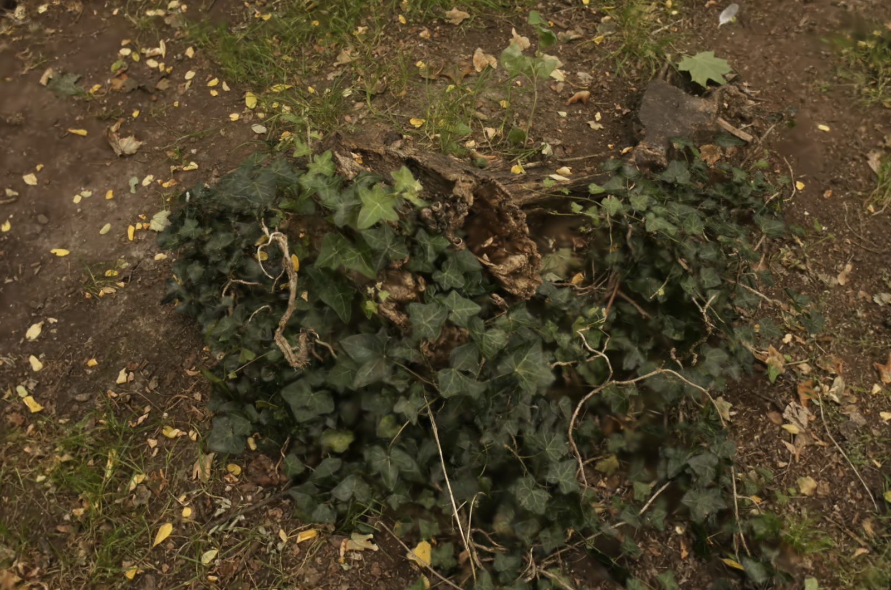
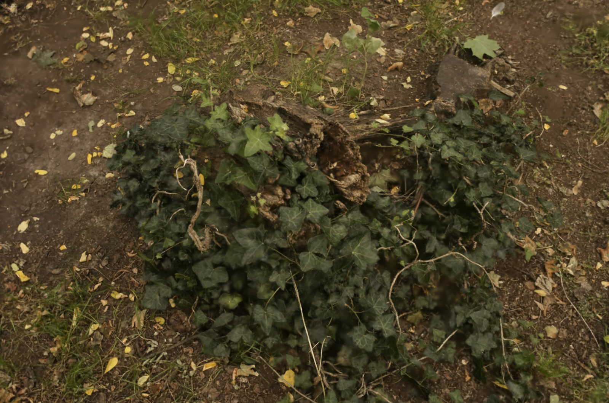
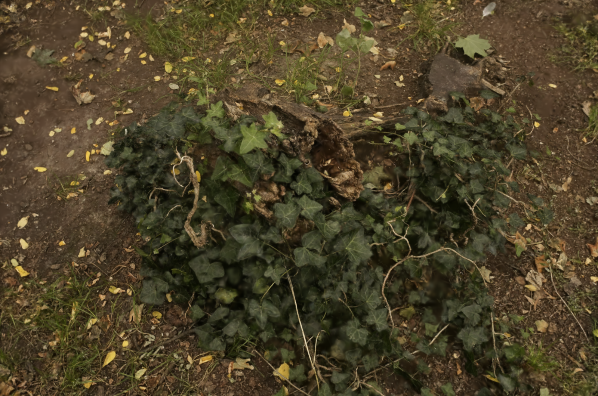

# Method Summary — MipNeRF360 (7 scenes)

Canonical methods:

| # | Method | Script | Notes |
|---|--------|--------|-------|
| 1 | Scaffold-GS (baseline) | `train_method.sh --method baseline` | Shared MLP |
| 2 | flat MoE | `train_method.sh --method moe` | 8 experts, Top-2 |
| 3 | MoE+GNN | `train_method.sh --method moe_gnn` | MoE with GNN (warm-start from moe) |
| 4 | Tree+GNN | `train_method.sh --method tree_gnn` | Growing tree MoE + GNN (start 4, max 3 grows) |

Metrics from `results.json` (`ours_30000`). MoE+GNN numbers are the winning warm-start recipe (legacy name: continue-train).

---

## 1. PSNR ↑

| Scene | baseline | flat MoE | MoE+GNN |
|---| ---: | ---: | ---: |
| bicycle | 25.171 | 25.217 | 25.436 |
| bonsai | 32.379 | 33.184 | 33.946 |
| counter | 29.452 | 29.580 | 30.052 |
| garden | 27.315 | 27.481 | 27.689 |
| kitchen | 31.338 | 31.865 | 32.223 |
| room | 32.067 | 32.235 | 32.703 |
| stump | 26.653 | 26.663 | 26.811 |
| **mean** | **29.196** | **29.461** | **29.837** |

## 2. SSIM ↑

| Scene | baseline | flat MoE | MoE+GNN |
|---| ---: | ---: | ---: |
| bicycle | 0.7434 | 0.7482 | 0.7554 |
| bonsai | 0.9462 | 0.9518 | 0.9551 |
| counter | 0.9158 | 0.9190 | 0.9229 |
| garden | 0.8508 | 0.8526 | 0.8572 |
| kitchen | 0.9305 | 0.9337 | 0.9360 |
| room | 0.9301 | 0.9329 | 0.9354 |
| stump | 0.7643 | 0.7635 | 0.7689 |
| **mean** | **0.8687** | **0.8717** | **0.8758** |

## 3. LPIPS ↓

| Scene | baseline | flat MoE | MoE+GNN |
|---| ---: | ---: | ---: |
| bicycle | 0.2594 | 0.2465 | 0.2367 |
| bonsai | 0.1819 | 0.1695 | 0.1634 |
| counter | 0.1873 | 0.1768 | 0.1702 |
| garden | 0.1338 | 0.1279 | 0.1220 |
| kitchen | 0.1196 | 0.1136 | 0.1099 |
| room | 0.1888 | 0.1799 | 0.1754 |
| stump | 0.2617 | 0.2575 | 0.2479 |
| **mean** | **0.1904** | **0.1817** | **0.1751** |

## 4. Sample images

| Scene | baseline | flat MoE | MoE+GNN |
|---| --- | --- | --- |
| bicycle |  |  |  |
| bonsai |  |  |  |
| counter |  |  |  |
| garden |  |  |  |
| kitchen |  |  |  |
| room |  |  |  |
| stump |  |  |  |

---

## Run stamps used

| Scene | Method | Run stamp | Source folder |
|---|---|---|---|
| bicycle | baseline | `2026-07-18_10:39:00` | `baseline` |
| bicycle | flat MoE | `2026-07-18_11:01:55` | `moe` |
| bicycle | MoE+GNN | `2026-07-22_22:13:12` | `dynamic_tree_moe_gnn` (legacy path) |
| bonsai | baseline | `2026-07-18_15:04:39` | `baseline` |
| bonsai | flat MoE | `2026-07-18_15:24:49` | `moe` |
| bonsai | MoE+GNN | `2026-07-22_23:52:12` | `dynamic_tree_moe_gnn` (legacy path) |
| counter | baseline | `2026-07-18_19:37:58` | `baseline` |
| counter | flat MoE | `2026-07-18_19:59:17` | `moe` |
| counter | MoE+GNN | `2026-07-23_00:40:23` | `dynamic_tree_moe_gnn` (legacy path) |
| garden | baseline | `2026-07-18_23:33:59` | `baseline` |
| garden | flat MoE | `2026-07-18_23:58:17` | `moe` |
| garden | MoE+GNN | `2026-07-23_01:56:49` | `dynamic_tree_moe_gnn` (legacy path) |
| kitchen | baseline | `2026-07-19_04:19:20` | `baseline` |
| kitchen | flat MoE | `2026-07-19_04:45:50` | `moe` |
| kitchen | MoE+GNN | `2026-07-22_22:58:33` | `dynamic_tree_moe_gnn` (legacy path) |
| room | baseline | `2026-07-19_09:56:39` | `baseline` |
| room | flat MoE | `2026-07-19_10:14:50` | `moe` |
| room | MoE+GNN | `2026-07-23_01:21:01` | `dynamic_tree_moe_gnn` (legacy path) |
| stump | baseline | `2026-07-19_12:38:39` | `baseline` |
| stump | flat MoE | `2026-07-19_12:56:14` | `moe` |
| stump | MoE+GNN | `2026-07-22_21:42:53` | `dynamic_tree_moe_gnn` (legacy path) |
